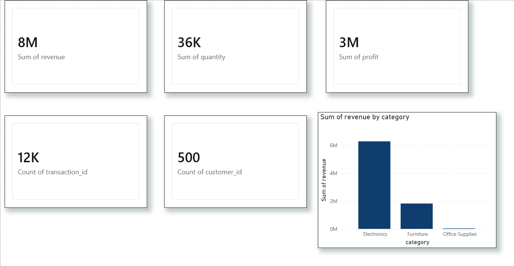
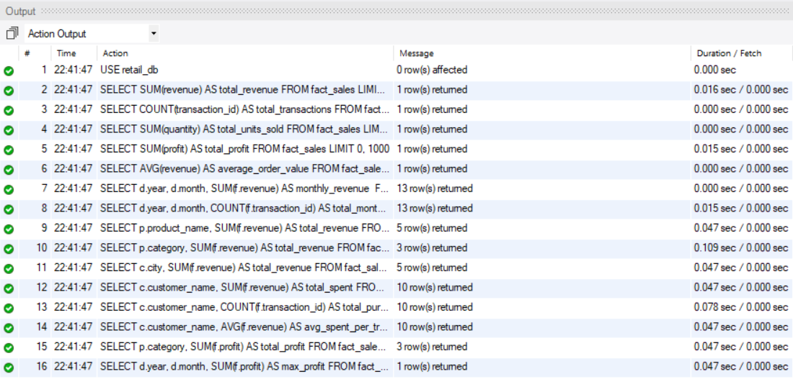

# Retail Sales ETL & Analytics Pipeline

# 🛒 Retail Sales ETL & Analytics Pipeline

### 📊 Power BI Dashboard

### 🔍 SQL Analytics Validation

## Overview
An end-to-end Data Engineering and Business Intelligence project that extracts raw retail transaction data, cleans and transforms it using Python and Pandas, loads it into a MySQL Star Schema data warehouse, and visualizes key business KPIs through an interactive Power BI dashboard.

##  System Architecture & Star Schema
The pipeline follows a standard batch-processing architecture:
*   **Extract:** A Python script generates 12,000 raw simulated retail sales records across 500 simulated customers[cite: 3]. 
*   **Transform:** Pandas is used to handle missing values, remove duplicates, enforce data types, and calculate derived metrics like Revenue and Total Cost[cite: 3].
*   **Load:** SQLAlchemy bulk-inserts the transformed CSV data into a MySQL data warehouse[cite: 2].

The MySQL database is structured as a Star Schema for optimal read performance and analytical querying[cite: 2, 3]:
*   `fact_sales`: Contains primary measures including quantity, revenue, and profit[cite: 3].
*   `dim_customer`: Contains customer attributes and demographics like their city[cite: 3].
*   `dim_product`: Contains product categories and base costs[cite: 3].
*   `dim_date`: Contains time-series analysis dimensions broken down by year, month, and day[cite: 3].

## ⚙️ End-to-End Pipeline Workflow
1.  **Data Generation:** Python simulates a realistic retail dataset containing 12,000 sales transactions[cite: 3]. 
2.  **Data Cleaning & Transformation:** Missing values are handled, duplicates are dropped, and key metrics such as revenue and profit are generated using Pandas[cite: 3].
3.  **Data Modeling:** Data is organized into a Star Schema comprising four connected tables: Fact Sales, Customers, Products, and Dates[cite: 3].
4.  **Data Loading:** A Python-based ETL pipeline script automatically establishes a database connection and replaces/loads the processed data into MySQL[cite: 2].
5.  **SQL Analysis & Validation:** 15 SQL queries were developed to validate the data and generate insights, including top customers and best-performing product categories[cite: 1].
6.  **Dashboard & Visualization:** Power BI connects to MySQL to build an interactive dashboard for monitoring key business metrics and trends.

## Key Achievements
*   **Data Volume Processed:** Generated and processed 12,000 retail transactions[cite: 3].
*   **Data Warehouse:** Built 1 Fact Table and 3 Dimension Tables in a structured Star Schema[cite: 2, 3].
*   **SQL Analytics:** Developed and executed 15 analytical queries uncovering insights like top products by revenue and best-performing months by profit[cite: 1].
*   **Business Intelligence:** Designed a Power BI dashboard tracking 6 core KPIs.

## Tech Stack
*   **Python (Pandas, NumPy, SQLAlchemy):** Utilized for data generation, extraction, cleaning, and transformation[cite: 2, 3].
*   **MySQL:** Used for relational data warehouse storage and referential integrity validation.
*   **SQL:** Handled aggregation, window functions, and business logic querying[cite: 1].
*   **Power BI:** Managed data modeling, DAX, and interactive data visualization.
